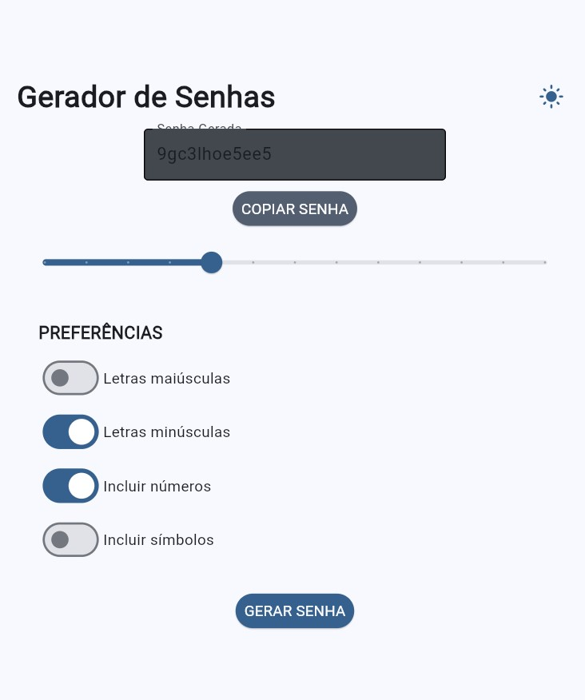
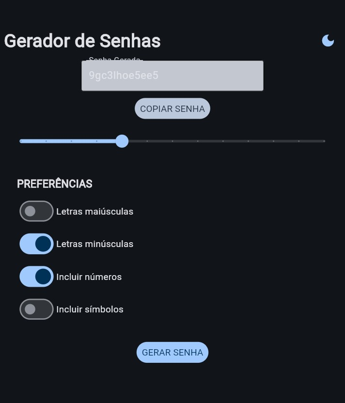
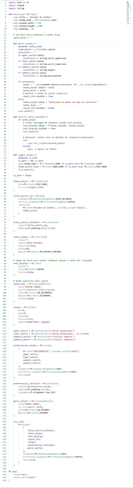

# 🔐 Password Generator - Gerador de Senhas

Um aplicativo interativo e seguro para geração de senhas, desenvolvido em **Python** com o **framework Flet**. Crie senhas fortes, seguras e personalizadas com criptografia de ponta a ponta para armazenamento.

## 🎯 Apresentação

O **Password Generator** é um gerador de senhas profissional que combina usabilidade com segurança:

- Gera senhas aleatórias e criptograficamente seguras
- Permite personalização do tamanho e tipos de caracteres
- Armazena senhas de forma **criptografada** com senha mestre
- Interface moderna com temas claro e escuro
- Tudo em uma única ferramenta leve

---

## ✨ Funcionalidades

### Geração de Senhas
- 🔐 **Criptografia segura** usando `secrets.choice()` (criptograficamente seguro)
- 📏 **Controle de tamanho** de 8 a 32 caracteres
- 🔤 **Opções de caracteres**:
  - Letras maiúsculas (A-Z)
  - Letras minúsculas (a-z)
  - Números (0-9)
  - Símbolos especiais (!@#$%...)

### Gerenciamento
- 📋 **Copiar para área de transferência**
- 💾 **Salvar senhas criptografadas** com proteção por senha mestre
- 🗑️ **Limpar interface** para nova geração
- 👁️ **Mostrar/ocultar** a senha gerada

### Interface
- 🌓 **Alternância de tema** claro/escuro
- 📊 **Layout responsivo** e moderno
- 🎯 **Foco intuitivo** nas funcionalidades principais

---

## 🛠️ Tecnologias

| Tecnologia | Versão | Uso |
|------------|--------|-----|
| **Python** | 3.8+ | Linguagem principal |
| **Flet** | 1.0.5 | Interface gráfica |
| **Cryptography** | 41.0.0+ | Criptografia Fernet |
| **secrets** | padrão | Geração segura de senhas |

---

## 📸 Capturas de Tela

### Modo Claro


### Modo Escuro


### Código Fonte


---

## 🚀 Como Executar

### Passo 1: Instale as dependências

```bash
pip install -r requirements.txt
```

### Passo 2: Execute o aplicativo

```bash
flet run src/gerador.py
```

> **Nota:** Na primeira execução, você será configurado com uma senha mestre que protegerá seus dados.

---

## 🔐 Geração de Senhas Seguras

O gerador utiliza o módulo **`secrets`** da biblioteca padrão do Python, que é criptograficamente seguro:

```python
import secrets

senha = "".join(secrets.choice(caracteres) for _ in range(comprimento))
```

**Diferença crucial:**
- `random.choice()` → **NÃO criptograficamente seguro** (previsível)
- `secrets.choice()` → **Criptograficamente seguro** (para senhas)

---

## 🔒 Armazenamento Criptografado

As senhas salvas são protegidas com criptografia de ponta a ponta:

### Como funciona:
1. **Senha Mestre**: Crie uma senha mestre única (mínimo 6 caracteres)
2. **Derivação de chave**: PBKDF2HMAC com 480.000 iterações
3. **Criptografia**: Fernet (AES-128 + HMAC-SHA256)
4. **Armazenamento**: Arquivo criptografado em `%APPDATA%\PasswordGen\`

### Vantagens:
- ✅ Dados protegidos mesmo se o computador for roubado
- ✅ Nenhuma chave fixa no código
- ✅ Migração automática de senhas antigas

---

## ⚠️ Aviso Importante

> **Se você esquecer a senha mestre, os dados criptografados NÃO PODERÃO SER RECUPERADOS.**
>
> A senha mestre é **única e irrecuperável**. Guarde-a em um local seguro.
>
> **Recomendações:**
> - Anote a senha mestre e guarde em local físico seguro
> - Não use caracteres fáceis de adivinhar
> - Considere usar um gerenciador de senhas para armazenar a senha mestre

---

## 📁 Estrutura do Projeto

```
Gerador-de-Senhas-python/
├── src/
│   └── gerador.py          # Código principal
├── docs/
│   ├── Codigo.jpg          # Imagem do código
│   ├── ModoClaro.jpg       # Captura modo claro
│   └── ModoEscuro.jpg      # Captura modo escuro
├── assets/
│   └── icon.png            # Ícone do tema
├── .gitignore              # Arquivos a ignorar
├── requirements.txt          # Dependências
├── README.md               # Este arquivo
└── .gitattributes         # Configuração do Git
```

---

## 🛡️ Segurança

| Aspecto | Implementação |
|---------|--------------|
| Geração de senhas | `secrets.choice()` - Criptograficamente seguro |
| Criptografia armazenamento | Fernet (AES-128 + HMAC) |
| Derivação de chave | PBKDF2HMAC - 480.000 iterações |
| Salt | 16 bytes aleatórios por sessão |
| Arquivo de dados | `%APPDATA%\PasswordGen\senhas_criptografadas.bin` |

---

## 📄 Licença

Este projeto está sob a licença MIT - sinta-se livre para usar, modificar e distribuir.

---

## 🤝 Contribuição

Sinta-se à vontade para abrir issues ou pull requests para melhorias no projeto.

> **Nota de segurança**: Este projeto é para fins educacionais e pessoais. Não recomendamos o uso para armazenar credenciais críticas de produção sem revisão adicional de segurança.